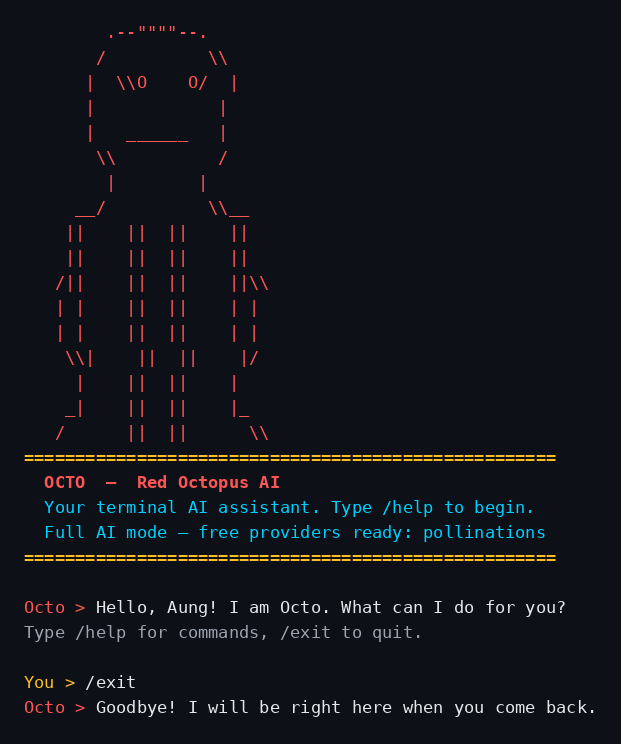
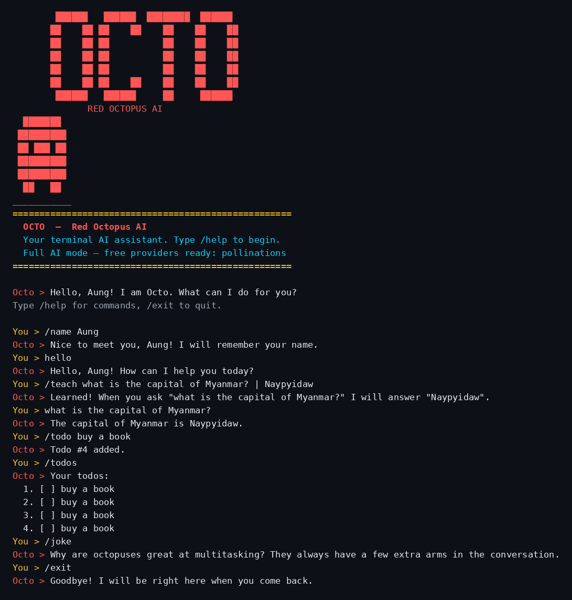
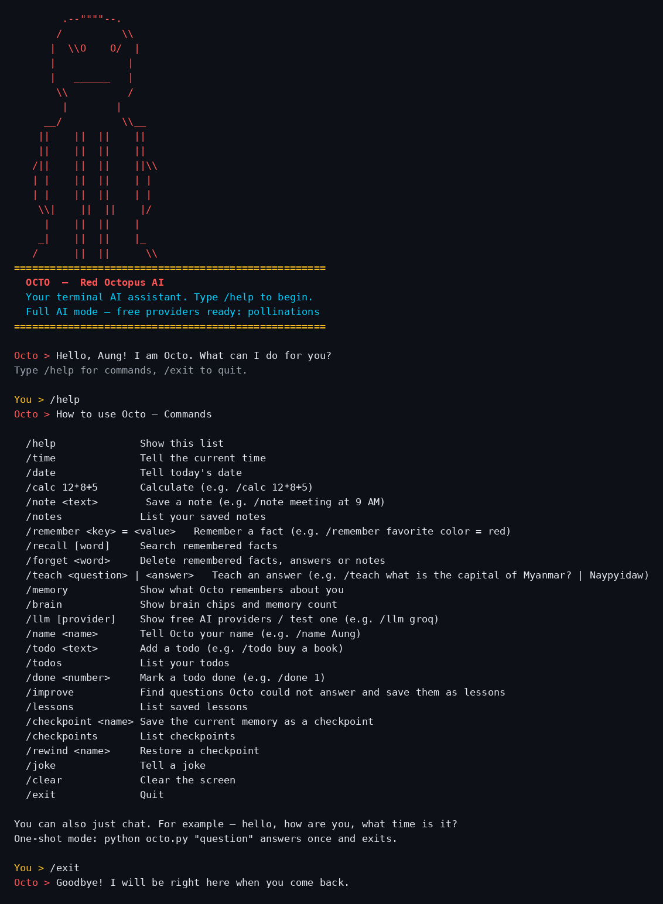

# Octo — Red Octopus AI


**A JARVIS-style AI chatbot that lives in your terminal.**
Talk to it in PowerShell or Terminal, teach it things, and it remembers —
even after you close it. English only.

> Honest note: Octo is **not** ChatGPT and not a trained model. Its built-in
> brain works fully offline. For open questions it can use **5 free AI APIs**
> (Groq, OpenRouter, Mistral, NVIDIA, Pollinations — **no Gemini**). Four
> need your own free key; Pollinations needs no key at all and works out
> of the box. No key is ever bundled with the project.

---

## Screenshots

Real output from the app — no mockups.

**Startup** — the octopus wakes up, greets you:



**Chatting** — teaching Octo an answer, then asking it back, plus todos:



**Help** — every command, with examples:



---

## What Octo can do

| Tool | What it does |
|---|---|
| Chat | Talk in English; small talk, time, date, jokes |
| Memory | Remembers your name, facts, answers you teach, notes, todos — survives restarts (`memory.json` + readable `MEMORY.md`) |
| Teach | `/teach question \| answer` — Octo answers it forever after |
| Improve | `/improve` finds questions Octo could not answer and saves them as lessons |
| Todos | `/todo`, `/todos`, `/done` — a persistent todo list |
| Checkpoints | `/checkpoint <name>` saves a memory snapshot; `/rewind <name>` restores it |
| Calculate | `/calc 12*8+5` — safe arithmetic, no `eval` tricks |
| Notes | `/note`, `/notes` — quick notes that persist |
| One-shot mode | `python octo.py "question"` — one answer, then exit (for scripts) |
| Full AI mode | 5 free APIs (Groq, OpenRouter, Mistral, NVIDIA, Pollinations) — open questions go to the first provider that answers, with your memory as context |
| `/llm` | Show provider status, test one with `/llm groq` |
| Personality | Edit `SOUL.md` to change how Octo talks |

---

## Install

**Requirements:** Python 3.10 or newer. Nothing else — no packages to install.

### Windows — PowerShell

```powershell
# 1. Check Python (if this fails, install it from https://www.python.org/downloads/)
python --version

# 2. Get the project
git clone https://github.com/aungzayyanaing/red-octopus-ai.git
cd red-octopus-ai

# 3. (Optional) copy the example env file for full-AI mode
copy .env.example .env
```

> If `python` is not recognised, try `py --version` instead and use `py`
> in place of `python` in the commands below. For the best colours, use
> **Windows Terminal** (free from the Microsoft Store) instead of the
> old console.

### macOS / Linux — Terminal

```bash
# 1. Check Python (most systems already have it)
python3 --version

# 2. Get the project
git clone https://github.com/aungzayyanaing/red-octopus-ai.git
cd red-octopus-ai

# 3. (Optional) copy the example env file for full-AI mode
cp .env.example .env
```

No `pip install` step: Octo uses only the Python standard library.

---

## Run

```bash
python octo.py        # Windows PowerShell
python3 octo.py       # macOS / Linux
```

You will see the red octopus, a greeting, and a `You > ` prompt.
Type anything to chat. Type `/help` for commands, `/exit` to quit.

**One-shot mode** — ask one question and exit (great for scripts):

```bash
python octo.py "what time is it?"
python octo.py "tell me a joke"
```

**Shell alias** (optional, TerminalGPT-style):

```bash
# macOS / Linux — add to ~/.bashrc or ~/.zshrc
alias octo='python3 ~/red-octopus-ai/octo.py'
```

```powershell
# Windows PowerShell — add to your $PROFILE
function octo { python C:\path\to\red-octopus-ai\octo.py $args }
```

---

## Commands

| Command | What it does | Example | What appears |
|---|---|---|---|
| `/help` | Show all commands | `/help` | The command list |
| `/time` | Current time | `/time` | `It is 07:29 PM now.` |
| `/date` | Today's date | `/date` | `Today is Friday, November 20, 2026.` |
| `/calc <expr>` | Calculate | `/calc 12*8+5` | `12*8+5 = 101` |
| `/note <text>` | Save a note | `/note meeting at 9 AM` | `Note #1 saved.` |
| `/notes` | List notes | `/notes` | Your saved notes |
| `/remember <key> = <value>` | Remember a fact | `/remember favorite color = red` | `Remembered: "favorite color = red".` |
| `/recall [word]` | Search remembered facts | `/recall color` | `favorite color = red` |
| `/forget <word>` | Delete remembered things | `/forget color` | `Deleted 1 item(s).` |
| `/teach <q> \| <a>` | Teach an answer | `/teach what is the capital of Myanmar? \| Naypyidaw` | `Taught. When asked "what is the capital of myanmar?" I will answer "Naypyidaw".` |
| `/memory` | Show what Octo remembers | `/memory` | Name, facts, notes, todos, lessons |
| `/brain` | Show brain chips and memory count | `/brain` | Memories: 300 / 1,000,000 |
| `/llm [provider]` | Show free AI providers / test one | `/llm groq` | `groq works (1.2 s). Reply: OK` |
| `/name <name>` | Tell Octo your name | `/name Aung` | `Nice to meet you, Aung! I will remember your name.` |
| `/todo <text>` | Add a todo | `/todo buy a book` | `Todo #1 added.` |
| `/todos` | List todos | `/todos` | `[ ] buy a book` |
| `/done <n>` | Mark a todo done | `/done 1` | `Done: "buy a book".` |
| `/improve` | Find unanswered questions, save lessons | `/improve` | Unanswered questions + saved lessons |
| `/lessons` | List saved lessons | `/lessons` | `Teach me: ...` |
| `/checkpoint <name>` | Save a memory snapshot | `/checkpoint before-trip` | `Checkpoint "before-trip" saved.` |
| `/checkpoints` | List checkpoints | `/checkpoints` | `before-trip` |
| `/rewind <name>` | Restore a checkpoint | `/rewind before-trip` | Memory restored |
| `/joke` | Tell a joke | `/joke` | An octopus joke |
| `/lang mm\|en` | Switch language | `/lang en` | `Language switched to English.` |
| `/clear` | Clear the screen | `/clear` | Empty screen |
| `/exit` | Quit | `/exit` | Goodbye |

You can also just chat: `hello`, `how are you`, `what time is it?`

---

## Memory — how Octo remembers

Everything lives **on your computer**, in the project folder:

| File | What it is |
|---|---|
| `memory.json` | The real memory (machine-readable). Never edit by hand. |
| `MEMORY.md` | The same memory, human-readable. Read it like a notebook. Auto-updated on every save. |
| `SOUL.md` | Octo's personality. Edit it to change how Octo talks. |
| `checkpoints/` | Memory snapshots from `/checkpoint`. |

**Teach Octo:** `/teach <question> | <answer>`. Ask the same question
later and Octo answers it. **Remember facts:** `/remember <key> = <value>`,
find them with `/recall`. **Improve:** `/improve` scans your conversation
history, finds the questions Octo could not answer, and saves them as
lessons — then teach those with `/teach`. **Rewind:** `/checkpoint <name>`
before an experiment, `/rewind <name>` to go back.

Your memory is never uploaded anywhere. `.gitignore` keeps `memory.json`,
`MEMORY.md`, `.env` and `checkpoints/` out of git.

---

## Full AI mode — 5 free APIs, no Gemini

The offline brain answers small talk, time, calculations and everything
you taught it. For open questions ("explain quantum physics", "write a
poem"), Octo tries 5 free AI providers in order until one answers —
like a full AI. **Pollinations needs no key**, so full-AI mode works
immediately with zero setup. Add your own free keys to unlock the
faster providers:

| Provider | Key (your own, free) | Model | Free tier |
|---|---|---|---|
| Groq | `GROQ_API_KEY` — https://console.groq.com/keys | `openai/gpt-oss-120b` | No card: 30 req/min, 1,000 req/day |
| OpenRouter | `OPENROUTER_API_KEY` — https://openrouter.ai/keys | `meta-llama/llama-3.3-70b-instruct:free` | Free `:free` models: 20 req/min, 50 req/day |
| Mistral | `MISTRAL_API_KEY` — https://console.mistral.ai/api-keys | `mistral-small-latest` | Free experiment tier: ~1 req/sec |
| NVIDIA NIM | `NVIDIA_API_KEY` — https://build.nvidia.com | `meta/llama-3.3-70b-instruct` | Free tier, no card: 40 req/min |
| Pollinations | **No key needed** | `gpt-oss-20b` | Free anonymous lane: ~1 req per 45 sec |

1. Copy `.env.example` to `.env` and paste your own keys there.
2. Restart Octo. The banner lists the providers that are ready.
3. Check status any time with `/llm`, test one with `/llm groq`.

Octo sends your question to the provider together with your name,
your remembered facts and recent conversation — so its answers know
you. If every provider fails (no network, rate limit, bad key), Octo
falls back to the offline brain and keeps working. Keys stay in your
local `.env` file only.

**Tuning:** change the try order with `OCTO_LLM_ORDER` in `.env`
(e.g. `OCTO_LLM_ORDER=pollinations,groq`), pin one provider with
`OCTO_LLM_PROVIDER=groq`, or change a model with
`OCTO_GROQ_MODEL=llama-3.3-70b-versatile`.

---

## Troubleshooting

| Problem | Fix |
|---|---|
| `python: command not found` (Windows) | Install Python from python.org and tick **"Add Python to PATH"** during setup. Or use `py octo.py`. |
| `python3: command not found` (macOS/Linux) | Install Python 3.10+ with your package manager (`brew install python`, `sudo apt install python3`). |
| Colours look wrong / boxes instead of art (Windows) | Use **Windows Terminal** (Microsoft Store, free). The old console does not do ANSI colours well. |
| `Full AI mode` never appears | With no keys, only Pollinations is ready — it still counts as full AI. If the banner says offline, `.env` is not being read: run from the project folder. |
| A provider answers fail / empty | The key may be wrong, expired, or out of quota — `/llm` shows which keys are set. Octo tries the next provider, then falls back to the offline brain automatically. |
| Pollinations is slow / says "try again" | Its free anonymous lane allows about 1 request per 45 seconds. Wait a minute, or add a Groq key (fastest free tier). |
| Octo forgot everything | `memory.json` was deleted or you ran it from another folder. Always run from the project folder so it finds the same `memory.json`. |
| `ModuleNotFoundError` | You are running a file from the wrong folder. `cd` into the project folder first. |

---

## FAQ

**Is Octo really AI?**
Octo has two brains: a local rule-based brain that works offline, and
5 free API providers (your own keys, or Pollinations with no key) that
answer like a full AI. It is not a trained model and it does not claim
to be ChatGPT.

**Does Octo send my data anywhere?**
No — unless a free provider answers, in which case only your question
and your remembered facts go to that provider, exactly like using its
website. With no network call, nothing leaves your computer.

**Can I change Octo's personality?**
Yes — edit `SOUL.md`. In full-AI mode the new personality is used
immediately. The offline brain keeps its built-in character.

**Does it work on Windows?**
Yes — PowerShell + Python 3.10+. Use Windows Terminal for the best colours.

**Can I run it from anywhere?**
Run it from the project folder (or use the shell alias above) so Octo
finds the same `memory.json` every time.

---

## Project structure

```
red-octopus-ai/
├── octo.py            entry point — terminal UI, animated octopus, REPL
├── brain.py           offline brain — intents, small talk, calculator, jokes
├── memory.py          persistent memory — JSON + MEMORY.md + todos + checkpoints
├── llm.py             5 free AI providers (stdlib only, your keys only)
├── commands.py        every /command
├── SOUL.md            Octo's personality (editable)
├── .env.example       template for your free API keys (optional)
├── requirements.txt   empty on purpose — standard library only
├── make_screenshots.py   renders docs/screenshots/*.png from real output
├── assets/
│   └── octopus-mascot.png   the red octopus mascot
└── docs/
    └── screenshots/   01-startup.png, 02-chat.png, 03-help.png
```

## License

MIT — see [LICENSE](LICENSE). Copyright (c) 2026 Aung Zay Ya Naing.
